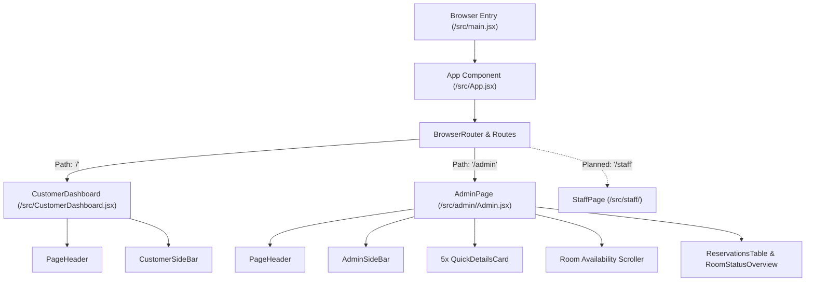
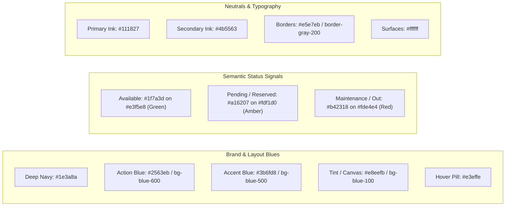

# StayEase HRMS - Project Context

> **Project Name:** StayEase Hotel Reservation & Management System (HRMS)  
> **Course / Context:** CC116 (School Project)  
> **Active Branch:** `front-end-dev`  
> **Stack:** React 19, Vite 8, Tailwind CSS v4, React Router v7, Lucide React  

---

## 1. Executive Summary

**StayEase** is a web-based Hotel Reservation and Management System (HRMS) engineered to streamline hotel operations and guest bookings. The application caters to three distinct personas:
1. **Guests / Customers:** Browse room catalogs, filter by view/status/rating, view room details, and manage bookings.
2. **Hotel Staff:** View daily operations, check-in/check-out management, and room turnaround tasks (in progress).
3. **Administrators:** High-level dashboard with occupancy metrics, room availability summaries, reservation logs, and SVG status breakdowns.

---

## 2. Technology Stack & Tooling

| Layer | Technology | Version | Purpose |
| :--- | :--- | :--- | :--- |
| **Runtime & Build** | [Vite](https://vite.dev/) | `^8.3.0` | Next-gen frontend development server and bundler |
| **UI Framework** | [React](https://react.dev/) | `^19.2.8` | Component-based UI library (with React DOM `^19.2.8`) |
| **Routing** | [React Router](https://reactrouter.com/) | `^7.18.4` | Client-side routing (`BrowserRouter`, `Routes`, `Route`) |
| **Styling** | [Tailwind CSS v4](https://tailwindcss.com/) | `^4.3.3` | Utility-first CSS framework via `@tailwindcss/vite` |
| **Icons** | [Lucide React](https://lucide.dev/) | `^1.53.0` | Consistent SVG icon library |
| **Linting** | ESLint | `^10.10.0` | Code quality and React hooks / refresh rules |

---

## 3. Directory & File Structure

```text
StayEase/
├── public/                       # Static public assets
│   ├── favicon.svg               # Application browser icon
│   └── icons.svg                 # SVG sprite definitions
├── src/                          # Application source code
│   ├── admin/                    # Admin portal module
│   │   ├── components/
│   │   │   ├── components.jsx    # Metric cards, room cards, tables, SVG pie chart
│   │   │   └── roomCardAvailability.jsx # Legacy/duplicate admin widgets
│   │   └── Admin.jsx             # Admin dashboard page layout & composition
│   ├── api/                      # (Reserved) API client & mock data services
│   ├── assets/                   # Bundled static media
│   │   └── logo.png              # StayEase brand logo
│   ├── components/               # Global reusable UI components
│   │   ├── header.jsx            # Universal page header (logo + title + description)
│   │   └── sidebar.jsx           # Role-based sidebar navigation shells
│   ├── staff/                    # (Reserved) Staff portal module
│   ├── App.css                   # Global secondary styles (currently empty)
│   ├── App.jsx                   # Application router root
│   ├── CustomerDashboard.jsx     # Customer portal shell (header + customer sidebar)
│   ├── customerpage.jsx          # Standalone customer room catalog & hero page
│   ├── customerpagecss.css       # Dedicated BEM styling & tokens for customer page
│   ├── index.css                 # Tailwind v4 import entry point (`@import "tailwindcss";`)
│   └── main.jsx                  # React DOM root entry point
├── eslint.config.js              # ESLint configuration
├── index.html                    # Root HTML document
├── package.json                  # NPM dependencies & build scripts
├── README.md                     # Project setup guide
└── vite.config.js                # Vite configuration with React & Tailwind plugins
```

---

## 4. Application Architecture & Routing

The application uses client-side routing managed by React Router v7 inside [`src/App.jsx`](file:///home/movements/Documents/HTML_Codes/School/StayEase/src/App.jsx):



### Core Route Definitions
- **`/` (Customer View):** Renders [`CustomerDashboard`](file:///home/movements/Documents/HTML_Codes/School/StayEase/src/CustomerDashboard.jsx). Hosts the top header and [`CustomerSideBar`](file:///home/movements/Documents/HTML_Codes/School/StayEase/src/components/sidebar.jsx#L48-L56).
- **`/admin` (Admin View):** Renders [`AdminPage`](file:///home/movements/Documents/HTML_Codes/School/StayEase/src/admin/Admin.jsx). Full administrative dashboard with KPI metrics, room availability lists, reservation logs, and an SVG pie chart overview.
- **`/staff` (Staff View - Planned):** Dedicated space in [`src/staff`](file:///home/movements/Documents/HTML_Codes/School/StayEase/src/staff) utilizing [`StaffSideBar`](file:///home/movements/Documents/HTML_Codes/School/StayEase/src/components/sidebar.jsx#L37-L46).

---

## 5. Component Breakdown & Responsibilities

### 5.1 Global Shared Components ([`src/components/`](file:///home/movements/Documents/HTML_Codes/School/StayEase/src/components))

1. **[`PageHeader`](file:///home/movements/Documents/HTML_Codes/School/StayEase/src/components/header.jsx#L3-L15):**
   - Renders the brand logo inside a fixed 200px column aligning with the sidebar.
   - Displays page title (`title`) and subtitle/context (`desc`).
   - Bottom border separates navigation from page body.
2. **[`SideBarShell`](file:///home/movements/Documents/HTML_Codes/School/StayEase/src/components/sidebar.jsx#L4-L12):**
   - Fixed `200px` width sidebar container with a `sticky top-0 h-screen` interior.
   - Provides consistent structural frame across user roles.
3. **[`NavItem`](file:///home/movements/Documents/HTML_Codes/School/StayEase/src/components/sidebar.jsx#L14-L23):**
   - Clickable navigation item rendering a Lucide icon and text label.
   - Hover state with soft blue highlight (`hover:bg-[#e3effe]`).
4. **Role Sidebars:**
   - [`AdminSideBar`](file:///home/movements/Documents/HTML_Codes/School/StayEase/src/components/sidebar.jsx#L25-L35): Dashboard, Room management, Reservations, Reports, Reviews & ratings.
   - [`StaffSideBar`](file:///home/movements/Documents/HTML_Codes/School/StayEase/src/components/sidebar.jsx#L37-L46): Dashboard, Room management, Reservations, Reports.
   - [`CustomerSideBar`](file:///home/movements/Documents/HTML_Codes/School/StayEase/src/components/sidebar.jsx#L48-L56): Rooms and Accommodations, My reservations, Customer Support.

### 5.2 Admin Dashboard Components ([`src/admin/components/components.jsx`](file:///home/movements/Documents/HTML_Codes/School/StayEase/src/admin/components/components.jsx))

1. **`QuickDetailsCard`:**
   - High-level KPI metric block displaying card title, numerical value, colored Lucide icon badge, and bottom contextual comment.
2. **`RoomAvailabilityCard`:**
   - Card representing room tiers (Standard, Deluxe, Executive Suite, Family).
   - Features room preview thumbnail, description, and status pills (occupied count vs available count).
3. **`ReservationsTable` & `StatusBadge`:**
   - Responsive tabular view of today's guest reservations (Guest Name, Room no., Check-in, Check-out, Status).
   - Pill status styling (`Checked-in` in light green, `Pending` in blue, `Checked-out` in soft yellow).
4. **`PieChart` & `RoomStatusOverview`:**
   - Handcrafted mathematical SVG pie/donut chart utilizing trigonometry (`Math.sin`, `Math.cos`) to generate dynamic SVG arc paths (`M... L... A... Z`).
   - Legend with color swatches, counts, and calculated percentages.

### 5.3 Customer Page Components ([`src/customerpage.jsx`](file:///home/movements/Documents/HTML_Codes/School/StayEase/src/customerpage.jsx))

- **Hero Banner & Carousel:** Hero headline, logo container, and multi-slide image stage with dot indicators.
- **Filter Bar:** Real-time search by room number or name, status dropdown (Available, Reserved, Maintenance), and minimum star rating filter (All, 3+, 4+, 5 stars).
- **Room Grid & Cards:** Grid of room cards with thumbnails, view titles, pricing, amenity tags, star rating reviews, and booking action links.
- **Pagination:** Dynamic page calculations with active page pills.

---

## 6. Styling Architecture & Design System

The project currently exhibits a **hybrid styling model**: utility-first Tailwind CSS v4 in the shared shell and admin dashboard, alongside custom BEM-structured CSS in the customer portal.

### 6.1 Design Tokens & Color Palette



#### Detailed Token Reference
- **Brand Blues:**
  - Dark Primary: `#1e3a8a` (`--blue-900`)
  - Primary Action: `#2563eb` (`--blue-600`) / `#3b6fd8` (`--blue-500`)
  - Background Tint: `#e8eefb` to `#f6f8fd` (gradient) / `bg-blue-100` (admin canvas)
  - Interactive Hover: `#e3effe` (sidebar item hover)
- **Status Indicators:**
  - **Available / Checked-in:** Soft Green (`#e3f5e8` background, `#1f7a3d` text / `bg-green-200`)
  - **Reserved / Occupied / Pending:** Soft Amber / Yellow (`#fdf1d0` background, `#a16207` text / `bg-yellow-100` / `bg-blue-400`)
  - **Maintenance / Check-out:** Soft Red (`#fde4e4` background, `#b42318` text / `bg-red-200`)
  - **Rating Stars:** Amber Gold (`#f5a623`)
- **Typography:**
  - Font Family: `'Inter', system-ui, -apple-system, sans-serif`
  - Scales: Sub-labels (`9px-11px`), Body (`12px-14px`), Headings (`16px-24px`, bold weights 600/700)

---

### 6.2 Layout Mechanics

1. **Full-Viewport Shell Pattern:**
   ```jsx
   <main className="flex min-h-screen flex-col">
     <PageHeader />
     <div className="flex flex-1">
       <Sidebar />
       <div className="flex-1 min-w-0 overflow-y-auto">
         {/* Main Content */}
       </div>
     </div>
   </main>
   ```
   - Prevents scrollbars on the window frame while allowing interior panels to scroll independently.
   - `min-w-0` on flex children prevents overflow issues with nested tables and flex grids.

2. **Fixed Sidebar + Dynamic Canvas:**
   - Width is locked to `w-[200px]` with `shrink-0`.
   - The logo box in `PageHeader` is exactly `w-[200px] shrink-0 border-r-2`, creating a continuous vertical grid line down the entire left side.

3. **Horizontal Scrolling Row:**
   - Admin room availability cards use `flex gap-2 overflow-x-auto` to allow horizontal sliding across room tiers without breaking dashboard layout.

4. **BEM Component Styling (`customerpagecss.css`):**
   - Uses strict block-element-modifier syntax:
     - Block: `.card`, `.carousel`, `.badge`
     - Element: `.card__head`, `.card__title`, `.badge__dot`
     - Modifier: `.badge--available`, `.badge--reserved`, `.dot--active`

---

## 7. Current Technical Discrepancies & Recommendations

### 7.1 Immediate Fixes Needed

1. **Broken Component Import in `customerpage.jsx`:**
   - `customerpage.jsx` imports `{ Placeholder, Carousel, RoomGrid, ... }` from `'./components.jsx'`, which does not exist in `src/`.
   - *Fix:* Either create `src/components/customerComponents.jsx` or move the UI building blocks into modular component files.
2. **Component Naming Collision in `CustomerDashboard.jsx`:**
   - `src/CustomerDashboard.jsx` defines `export default function AdminPage()`.
   - *Fix:* Rename the exported function to `CustomerDashboard`.
3. **Duplicated Admin Components:**
   - `src/admin/components/roomCardAvailability.jsx` duplicates `ReservationsTable`, `PieChart`, and `RoomStatusOverview` already present in `src/admin/components/components.jsx`.
   - *Fix:* Remove redundant declarations and consolidate exports.

### 7.2 Styling Unification Roadmap

As noted in the Git commit history:
> *"TODO: use index.css to define all the styling that will be used across the pages"*

- **Tailwind v4 `@theme` integration:** Replace `:root` variables in `customerpagecss.css` with `@theme` block in `src/index.css`:
  ```css
  @import "tailwindcss";

  @theme {
    --color-brand-900: #1e3a8a;
    --color-brand-600: #2563eb;
    --color-brand-500: #3b6fd8;
    --color-brand-100: #dbe6fb;
  }
  ```
- **Porting BEM to Tailwind Utilities:** Migrate `.card`, `.badge`, `.hero`, and `.filter-bar` to standard Tailwind utilities to keep the styling paradigm unified across customer, staff, and admin portals.

---

## 8. Summary Table of Key Files

| File | Primary Role | Styling Paradigm |
| :--- | :--- | :--- |
| [`src/App.jsx`](file:///home/movements/Documents/HTML_Codes/School/StayEase/src/App.jsx) | Router controller | N/A |
| [`src/components/header.jsx`](file:///home/movements/Documents/HTML_Codes/School/StayEase/src/components/header.jsx) | Global Header | Tailwind v4 utilities |
| [`src/components/sidebar.jsx`](file:///home/movements/Documents/HTML_Codes/School/StayEase/src/components/sidebar.jsx) | Shared Navigation Shell | Tailwind v4 utilities |
| [`src/admin/Admin.jsx`](file:///home/movements/Documents/HTML_Codes/School/StayEase/src/admin/Admin.jsx) | Admin Dashboard View | Tailwind v4 utilities |
| [`src/admin/components/components.jsx`](file:///home/movements/Documents/HTML_Codes/School/StayEase/src/admin/components/components.jsx) | Admin Dashboard Widgets | Tailwind v4 utilities + Inline SVG |
| [`src/CustomerDashboard.jsx`](file:///home/movements/Documents/HTML_Codes/School/StayEase/src/CustomerDashboard.jsx) | Customer Portal Shell | Tailwind v4 utilities |
| [`src/customerpage.jsx`](file:///home/movements/Documents/HTML_Codes/School/StayEase/src/customerpage.jsx) | Room Catalog & Search | BEM Classes (`customerpagecss.css`) |
| [`src/customerpagecss.css`](file:///home/movements/Documents/HTML_Codes/School/StayEase/src/customerpagecss.css) | Customer Page Stylesheet | CSS Variables + BEM |
| [`src/index.css`](file:///home/movements/Documents/HTML_Codes/School/StayEase/src/index.css) | Global Tailwind Entry | `@import "tailwindcss";` |
